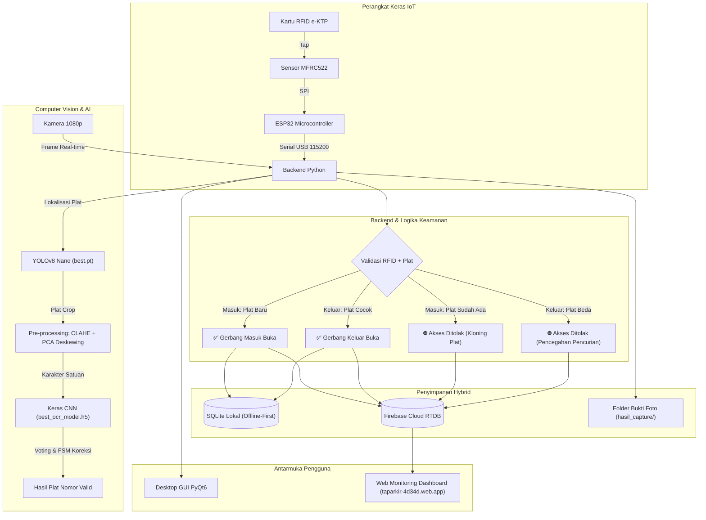

# 🚗 Sistem Parkir Pintar (Dual-Layer Authentication: IoT RFID + Computer Vision ALPR)

[](https://taparkir-4d34d.web.app/)
[](https://www.python.org/)
[](https://riverbankcomputing.com/software/pyqt/)
[](https://github.com/ultralytics/ultralytics)
[](https://www.tensorflow.org/)
[](https://www.espressif.com/)
[](https://firebase.google.com/)
[](LICENSE)

Aplikasi desktop cerdas berbasis **Windows** untuk otomasi gerbang parkir dengan sistem **Keamanan Autentikasi Ganda (*Dual-Layer Authentication*)**: memvalidasi identitas kartu **RFID e-KTP (IoT ESP32)** dengan **Plat Nomor Kendaraan (Computer Vision: YOLOv8 + CNN OCR)**, didukung arsitektur **Hybrid Database** (Offline-First SQLite lokal + Cloud Firebase Realtime Database) serta **Web Monitoring Dashboard**.

🌐 **Akses Dashboard Web Real-time:** [https://taparkir-4d34d.web.app/](https://taparkir-4d34d.web.app/)

---

## 📌 Daftar Isi
- [Live Web Monitoring](#-live-web-monitoring)
- [Arsitektur Sistem](#-arsitektur-sistem)
- [Hasil Evaluasi & Grafik Pelatihan Model (Bab 4 Skripsi)](#-hasil-evaluasi--grafik-pelatihan-model-bab-4-skripsi)
- [Fitur Utama](#-fitur-utama)
- [Pipeline Computer Vision & Kecerdasan Buatan](#-pipeline-computer-vision--kecerdasan-buatan)
- [Struktur Repositori](#-struktur-repositori)
- [Kebutuhan Perangkat](#-kebutuhan-perangkat)
- [Panduan Instalasi & Penggunaan](#-panduan-instalasi--penggunaan)
- [Konfigurasi Firebase](#-konfigurasi-firebase)
- [Integrasi Perangkat Keras (ESP32 RFID)](#-integrasi-perangkat-keras-esp32-rfid)
- [Skrip Penelitian Bab 4 Skripsi](#-skrip-penelitian-bab-4-skripsi)
- [Troubleshooting](#-troubleshooting)

---

## 🌐 Live Web Monitoring

Sistem terhubung langsung ke cloud untuk kebutuhan monitoring jarak jauh:

👉 **URL Dashboard Resmi:** [https://taparkir-4d34d.web.app/](https://taparkir-4d34d.web.app/)

Fitur pemantauan pada website:
1. **Panel Log & Peringatan Keamanan**: Merekam insiden penolakan akses secara *real-time* (misalnya jika kartu RFID ditap pada kendaraan yang berbeda dari data saat masuk).
2. **Panel Kendaraan Parkir Aktif**: Menampilkan jumlah dan daftar kendaraan yang saat ini sedang berada di dalam area parkir.
3. **Panel Riwayat Transaksi**: Mencatat seluruh histori masuk dan keluar kendaraan beserta bukti foto tangkapan kamera.

---

## 🏗️ Arsitektur Sistem



---

## 📊 Hasil Evaluasi & Grafik Pelatihan Model (Bab 4 Skripsi)

Seluruh metrik dan grafik berikut diambil langsung dari data pengujian resmi pada dokumen laporan Tugas Akhir / Skripsi:

### Ringkasan Metrik Kinerja Sistem

| Komponen Pengujian | Metrik Evaluasi | Nilai Capaian | Keterangan |
| :--- | :--- | :---: | :--- |
| **YOLOv8 Nano** (Lokalisasi Plat) | **Precision** | **98,03%** | Tingkat ketepatan deteksi bounding box |
| | **Recall** | **95,90%** | Tingkat keberhasilan menemukan objek pelat |
| | **mAP@0.50** | **98,51%** | Rata-rata presisi pada threshold IoU 0,50 |
| | **mAP@0.50:0.95** | **92,99%** | Rata-rata presisi pada rentang IoU ketat |
| | **Keberhasilan Deteksi Lapangan** | **100,00%** | 30 dari 30 pelat uji berhasil dilokalisasi |
| | **Training Box Loss** | **0,29206** | Penurunan kesalahan posisi box selama pelatihan |
| | **Validation Box Loss** | **0,39947** | Tingkat kestabilan validasi |
| **OCR CNN** (Klasifikasi Karakter) | **Training Accuracy** | **94,46%** | Tingkat akurasi pada data latih (Loss: 0,1936) |
| | **Validation Accuracy** | **88,07%** | Akurasi klasifikasi karakter individual (Loss: 0,6317) |
| | **Pengenalan Pelat Utuh Lapangan** | **83,33%** | 25 dari 30 kendaraan terbaca utuh 100% benar |
| **RFID RC522 (ESP32)** | **Keberhasilan Baca UID** | **100,00%** | 55 dari 55 pengujian berhasil (11 UID berbeda) |
| | **Rata-rata Waktu Respons** | **5,64 ms** | Rentang waktu pembacaan cepat antara 5–6 ms |
| **Autentikasi Ganda** | **Kesesuaian Logika 4 Skenario** | **100,00%** | Masuk/Keluar/Ditolak sesuai aturan keamanan |

---

### 1. Grafik Hasil Pelatihan YOLOv8 Nano (Gambar 4.8 Skripsi)
- **Dataset Latih:** 500 citra kendaraan roda dua ([Roboflow Dataset](https://universe.roboflow.com/best-zwljf/tugasakhir-rvuug)).
- Menggambarkan penurunan *Box Loss* dan kenaikan *Mean Average Precision* (mAP@0.50: 98,51%, mAP@0.50:0.95: 92,99%) selama 100 epoch.


*Gambar 4.8: Grafik Box Loss & Mean Average Precision (mAP) YOLOv8 Nano*

---

### 2. Grafik Hasil Pelatihan OCR CNN (Gambar 4.10 Skripsi)
- **Dataset Latih:** 47.985 citra karakter dalam 36 kelas alfanumerik `0-9` dan `A-Z` ([Kaggle Dataset](https://www.kaggle.com/datasets/caasperart/haarcascadeplatenumber)).
- Menggambarkan perkembangan *Training Accuracy* (mencapai 94,46%) dan *Validation Accuracy* (mencapai 88,07%), serta grafik *Loss*.


*Gambar 4.10: Grafik Akurasi & Loss Pelatihan vs Validasi Model CNN*

---

## ✨ Fitur Utama

1. **Autentikasi Ganda (*Dual Authentication*)**: Mencegah kecurangan kartu hilang/ditukar dengan mencocokkan identitas UID RFID dan identitas visual plat kendaraan.
2. **Anti-Tapping Palsu (*Anti-Passback*)**: Menolak akses masuk jika plat nomor yang sama terdeteksi masih tercatat berada di dalam area parkir.
3. **Pencegahan Pencurian Kendaraan**: Saat keluar, sistem memverifikasi apakah plat kendaraan yang keluar 100% cocok dengan plat saat kartu tersebut pertama kali masuk.
4. **Offline-First SQLite**: Sistem gerbang tetap bekerja lancar dan cepat tanpa ketergantungan koneksi internet.
5. **Real-time Cloud Sync (Firebase)**: Otomatis mengirim data transaksi dan representasi foto Base64 ke Firebase Realtime Database saat terhubung internet.
6. **GUI Modern PyQt6 (Multi-threaded)**: Video streaming real-time di thread terpisah (`QThread`) tanpa freeze saat inferensi AI.
7. **Simulasi Tap RFID**: Tombol simulasi tap pada GUI untuk pengujian alur perangkat lunak tanpa modul hardware.
8. **Perlindungan Privasi**: Data sensitif pada dokumentasi disamarkan untuk keamanan dan kepatuhan privasi data.

---

## 🧠 Pipeline Computer Vision & Kecerdasan Buatan

1. **Deteksi Plat (YOLOv8 Nano)**:
   - Menggunakan bobot terlatih `best.pt` dengan confidence threshold `0.5`.
   - Mengambil bounding box dengan area terbesar (kendaraan paling depan/dekat gerbang).
2. **Prapemrosesan Citra Tingkat Lanjut**:
   - **Pemotongan Margin**: Menghilangkan 3% sisi kiri dan 1.5% sisi kanan plat untuk membuang bingkai putih yang berpotensi keliru terbaca huruf `'I'`.
   - **CLAHE (*Contrast Limited Adaptive Histogram Equalization*)**: Meratakan kontras pada kondisi plat kusam atau pencahayaan ekstrem.
   - **Otsu Binarization**: Segmentasi adaptif hitam-putih.
   - **Auto-Deskewing (PCA)**: Menghitung sudut kemiringan karakter menggunakan *Principal Component Analysis* dan merotasi otomatis (rentang 3° s/d 40°).
   - **Y-Axis Median Alignment**: Memfilter kontur baut, emblem, atau logo berdasarkan ketinggian median karakter utama.
3. **Pengenalan Karakter (CNN Keras)**:
   - Klasifikasi 36 kelas karakter alphanumeric (`0-9` dan `A-Z`) menggunakan `best_ocr_model.h5`.
   - Normalisasi kanvas 28×28 piksel dengan *proportional padding* 4 piksel agar ujung lengkungan angka tidak terpotong.
4. **FSM & Heuristic Post-Processing**:
   - Menyesuaikan pola plat Indonesia: Karakter awal pasti Huruf Wilayah, karakter tengah pasti Angka, karakter akhir pasti Huruf Suffix.
   - **Sensor Kontur Pinggang (*Waistline Sensor*)**: Menganalisis kurva batas kanan karakter untuk membedakan huruf berlekuk `'B'` vs angka `'8'`, serta `'O'` vs `'0'`.
   - **Voting Temporal Multi-frame**: Menstabilkan hasil deteksi dari beberapa frame berturut-turut menggunakan `collections.Counter`.

---

## 📁 Struktur Repositori

```text
SistemParkir/
├── MainProgramTA.py                    # Backend core: MesinParkirThread, AI, IoT, DB
├── main_gui.py                         # Frontend GUI desktop (PyQt6)
├── best.pt                             # Model deteksi plat nomor (YOLOv8 Nano)
├── best_ocr_model.h5                   # Model OCR karakter plat (CNN Keras)
├── requirements.txt                    # Daftar dependency Python
├── .gitignore                          # Aturan ignore file kredensial, DB lokal, dan cache
├── LICENSE                             # Lisensi proyek (MIT)
├── README.md                           # Dokumentasi utama proyek
│
├── config/
│   ├── config.py                       # Konfigurasi terpusat (kamera, port, path)
│   └── kunci-firebase.json.example     # Template kredensial Firebase Service Account
│
├── arduino/
│   ├── README.md                       # Panduan lengkap wiring & setup ESP32
│   └── esp32_rfid/
│       └── esp32_rfid.ino              # Firmware Arduino IDE untuk ESP32 + RC522
│
├── web_dashboard/                      # Monitoring dashboard berbasis web (Firebase)
│   ├── index.html                      # Halaman antarmuka web monitoring
│   ├── style.css                       # Desain tampilan dashboard web
│   ├── 404.html                        # Halaman fallback 404
│   ├── firebase.json                   # Konfigurasi Firebase Hosting
│   └── .firebaserc                     # Inisialisasi ID proyek Firebase
│
├── assets/
│   ├── fonts/                          # Font plat nomor untuk pengujian
│   │   ├── font_plat.ttf
│   │   └── font_plat_standar.ttf
│   └── images/                         # Grafik resmi hasil pelatihan (Bab 4 Skripsi)
│       ├── Grafik_Pelatihan_YOLOv8.png # Gambar 4.8 Skripsi (Box Loss & mAP)
│       └── Grafik_Pelatihan_OCR_CNN.jpg# Gambar 4.10 Skripsi (Akurasi & Loss CNN)
│
├── scripts/                            # Skrip penelitian Bab 4 Skripsi
│   ├── README.md                       # Dokumentasi skrip penelitian
│   ├── train_ocr.py                    # Pelatihan model CNN OCR
│   ├── balance_dataset.py              # Augmentasi dataset karakter seimbang
│   ├── pengujian_bab4.py               # GUI pengambilan data pengujian Bab 4
│   └── dashboard_analisis.py           # Dashboard analisis computer vision
│
└── hasil_capture/                      # Direktori penyimpanan foto bukti masuk/keluar
    └── .gitkeep
```

---

## 💻 Kebutuhan Perangkat

### Software
- **Sistem Operasi**: Windows 10 / 11 (64-bit).
- **Python**: Python 3.9, 3.10, atau 3.11.
- **Arduino IDE**: Versi 2.0+ (dengan board ESP32 & library MFRC522 terpasang).
- **Driver USB**: CP210x atau CH340 sesuai modul USB-to-UART pada ESP32 Anda.

### Hardware
- **Webcam / Kamera USB**: Resolusi 1080p disarankan (minimal 720p).
- **Mikrokontroler**: ESP32 DevKit V1 (30 atau 38 pin).
- **Modul RFID**: MFRC522 13.56 MHz + Kartu e-KTP / Tag RFID Mifare 1K.
- **Kabel Jumper & Kabel Data USB**.

---

## 🚀 Panduan Instalasi & Penggunaan

### 1. Clone Repositori
```powershell
git clone https://github.com/USERNAME/SistemParkir.git
Set-Location SistemParkir
```

### 2. Buat dan Aktifkan Virtual Environment
```powershell
python -m venv .venv
.\.venv\Scripts\Activate.ps1
```
> *Catatan:* Jika eksekusi skrip dibatasi oleh sistem Windows, jalankan perintah berikut:
> ```powershell
> Set-ExecutionPolicy -Scope Process -ExecutionPolicy Bypass
> .\.venv\Scripts\Activate.ps1
> ```

### 3. Instal Dependency
```powershell
python -m pip install --upgrade pip
pip install -r requirements.txt
```

### 4. Konfigurasi Kredensial Firebase
Salin file template konfigurasi ke root direktori proyek:
```powershell
Copy-Item .\config\kunci-firebase.json.example .\kunci-firebase.json
```
Isi file `kunci-firebase.json` dengan kunci privat Service Account dari Firebase Console Anda (lihat [Konfigurasi Firebase](#-konfigurasi-firebase)).

### 5. Jalankan Aplikasi Desktop
Pastikan kamera dan ESP32 sudah terhubung, lalu jalankan:
```powershell
python main_gui.py
```

---

## 🔐 Konfigurasi Firebase

Proyek ini menggunakan **Firebase Realtime Database** untuk sinkronisasi data cloud.

1. Buka [Firebase Console](https://console.firebase.google.com/) dan buat proyek baru.
2. Buat **Realtime Database** pada lokasi `asia-southeast1` (Singapura) dengan aturan baca-tulis yang sesuai.
3. Buka **Project Settings** > **Service accounts**.
4. Klik **Generate new private key**, lalu simpan file JSON tersebut dengan nama `kunci-firebase.json` di root folder aplikasi.
5. ⚠️ **PERINGATAN KEAMANAN:** File `kunci-firebase.json` asli secara otomatis diabaikan oleh `.gitignore` sehingga tidak akan terunggah ke repositori publik.

---

## 🔌 Integrasi Perangkat Keras (ESP32 RFID)

Hubungkan pin modul **MFRC522** ke **ESP32** sesuai tabel berikut:

| Pin RC522 | Pin ESP32 | Keterangan |
|-----------|-----------|------------|
| 3.3V      | 3.3V      | ⚠️ **Jangan hubungkan ke 5V!** |
| RST       | GPIO 22   | Reset Pin |
| GND       | GND       | Ground Bersama |
| MISO      | GPIO 19   | VSPI MISO |
| MOSI      | GPIO 23   | VSPI MOSI |
| SCK       | GPIO 18   | VSPI SCK |
| SDA (SS)  | GPIO 21   | Slave Select (SS) |

Buka sketch pada `arduino/esp32_rfid/esp32_rfid.ino` di Arduino IDE, lalu upload ke board ESP32 Anda. Penjelasan lengkap tersedia di [arduino/README.md](arduino/README.md).

---

## 🧪 Skrip Penelitian Bab 4 Skripsi

Untuk mereproduksi hasil pelatihan atau pengujian:

- `python scripts/train_ocr.py` : Melatih model CNN untuk mengenali karakter plat nomor.
- `python scripts/balance_dataset.py` : Menyeimbangkan dataset karakter sebelum pelatihan.
- `python scripts/pengujian_bab4.py` : GUI khusus pengambilan data pengujian evaluasi.
- `python scripts/dashboard_analisis.py` : Dashboard visual untuk menganalisis akurasi segmentasi citra.

Dokumentasi rinci skrip ini dapat dibaca di [scripts/README.md](scripts/README.md).

---

## ❓ Troubleshooting

| Masalah | Penyebab Umum | Solusi |
|---------|---------------|--------|
| `ModuleNotFoundError` | Virtual environment belum aktif atau library belum terinstal | Pastikan prompt terminal menampilkan `(.venv)` lalu jalankan `pip install -r requirements.txt`. |
| `Modul RFID tidak terdeteksi` | Port COM tidak cocok atau kabel USB belum terpasang | Cek port COM ESP32 di Device Manager, lalu sesuaikan port pada list `SERIAL_PORTS` di `MainProgramTA.py`. Gunakan tombol **Simulasi Tap RFID** di GUI untuk pengujian cepat. |
| `Kamera tidak terbuka` | Indeks kamera salah atau kamera sedang dipakai aplikasi lain | Tutup aplikasi lain yang memakai kamera. Ubah indeks `cv2.VideoCapture(0)` menjadi `1` atau `2` jika menggunakan webcam eksternal. |
| `Gagal koneksi Firebase` | File `kunci-firebase.json` belum diisi atau tidak ditemukan | Salin template `config/kunci-firebase.json.example` ke root dengan nama `kunci-firebase.json` dan isi dengan kredensial asli. |

---

## 📄 Lisensi

Proyek ini dilisensikan di bawah lisensi **MIT License** - lihat berkas [LICENSE](LICENSE) untuk rincian lengkap.
